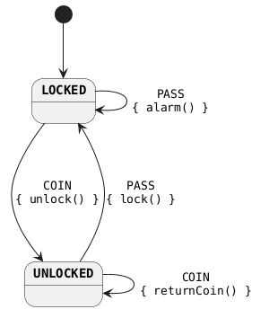

= Kotlin Finite-state machine
:project-version: 2.0.0

image:https://github.com/infosmid-org/kfsm/actions/workflows/snapshot.yml/badge.svg[Build Status,link=https://github.com/infosmid-org/kfsm/actions/workflows/snapshot.yml]
image:https://img.shields.io/maven-central/v/org.infosmid/kfsm.svg[Maven Central,link=https://central.sonatype.com/artifact/org.infosmid/kfsm]
image:https://img.shields.io/badge/License-Apache%202.0-blue.svg[License,link=LICENSE]

:toc: left
:toclevels: 3
:icons: font
:source-highlighter: highlight.js

This work is licensed under link:https://www.apache.org/licenses/LICENSE-2.0.html[Apache License 2.0]

kfsm is a small Kotlin library for finite state machines. It has a Kotlin DSL.

== Resources
* link:https://infosmid.org/projects/kfsm/index.html[Documentation]
* link:https://infosmid.org/projects/kfsm/javadoc/index.html[API Docs]
* link:https://github.com/infosmid-org/kfsm-viz[Visualization Support kfsm-io.jumpco.open.kfsm.viz]
* link:https://github.com/infosmid-org/kfsm-samples[Sample Project]
* link:https://github.com/infosmid-org/kfsm-web[Turnstile Sample for Browser]
* link:https://github.com/infosmid-org/kfsm-kvision-web[Turnstile Sample with KVision for Browser]
* link:https://github.com/infosmid-org/kfsm-android[Turnstile Sample for Android]
* link:https://github.com/infosmid-org/kfsm-spring[Turnstile Sample for Spring MVC]
* link:https://github.com/infosmid-org/kfsm-spring-rest[Turnstile Sample for Spring HATEOAS]
* link:https://github.com/infosmid-org/kfsm-android-compose-traffic[Traffic Intersection for Android Compose]

== Getting Started

In kfsm, an event can cause a transition from one state to another state.
A transition can run an action. It can also run an entry action and an exit action.

== Features
* Event-driven state machine.
* External transitions and internal transitions.
* Entry actions and exit actions for each state.
* Default actions for each state.
* Default entry actions and default exit actions.
* A query for the allowed events.
* Multiple state maps with push transitions and pop transitions.
* Automatic transitions.
* Externalized state.
* Typed event arguments and return values.

== Authors
* http://github.com/corneil[corneil]

== Star History
image::https://api.star-history.com/svg?repos=infosmid-org/kfsm&type=Date[Star History link="https://star-history.com/#infosmid-org/kfsm&Date"]

== Todo
* [x] Multiple state maps
* [x] Push transitions and pop transitions
* [x] Automatic transitions
* [x] Externalized state
* [x] Typed event arguments
* [x] Typed event return values
* [x] Simple visualization
* [x] Detailed visualization
* [x] Gradle plugin for visualization
* [x] Timeouts
* [x] Coroutines
* [ ] A different context type for nested state maps

== Quick Tutorial
This is the classic turnstile state machine from link:http://smc.sourceforge.net/[SMC].

=== Simple turnstile example
Assume that you must manage the state of a simple lock.
The `lock()` function must run only when the lock is not locked.
The `unlock()` function must run only when the lock is locked.

Use the DSL to declare a state machine definition that matches the diagram:

==== State Diagram

==== State Table

|===
|Start State |Event |End State |Action

|LOCKED
|PASS
|LOCKED
|alarm

|LOCKED
|COIN
|UNLOCKED
|unlock

|UNLOCKED
|PASS
|LOCKED
|lock

|UNLOCKED
|COIN
|UNLOCKED
|returnCoin
|===

==== Context class
[source,kotlin,numbered]
----
class Turnstile(var locked: Boolean = true) {
    fun unlock() {
        assert(locked) { "Cannot unlock when not locked" }
        println("Unlock")
        locked = false
    }

    fun lock() {
        assert(!locked) { "Cannot lock when locked" }
        println("Lock")
        locked = true
    }

    fun alarm() {
        println("Alarm")
    }

    fun returnCoin() {
        println("Return coin")
    }
    override fun toString(): String {
        return "Turnstile(locked=$locked)"
    }
}
----

==== Enums for States and Events
Declare two enums. One enum has the states. The other enum has the events.

[source,kotlin,numbered]
----
enum class TurnstileStates {
    LOCKED,
    UNLOCKED
}

enum class TurnstileEvents {
    COIN,
    PASS
}
----

==== Packaged definition and execution
[source,kotlin,numbered]
----
class TurnstileFSM(turnstile: Turnstile) {
    private val fsm = definition.create(turnstile)

    fun coin() = fsm.sendEvent(TurnstileEvents.COIN)
    fun pass() = fsm.sendEvent(TurnstileEvents.PASS)
    companion object {
        private val definition = stateMachine(
            TurnstileStates.values().toSet(),
            TurnstileEvents::class,
            Turnstile::class
        ) {
            initialState {
            if (locked)
                TurnstileStates.LOCKED
            else
                TurnstileStates.UNLOCKED
            }
            default {
                onEntry { startState, targetState, _ ->
                    println("entering:$startState -> $targetState for $this")
                }
                // default transition will invoke alarm
                action { state, event, _ ->
                    println("Default action for state($state) -> event($event) for $this")
                    alarm()
                }
                onExit { startState, targetState, _ ->
                    println("exiting:$startState -> $targetState for $this")
                }
            }
            // when current state is LOCKED
            whenState(TurnstileStates.LOCKED) {
                // external transition on COIN to UNLOCKED state
                onEvent(TurnstileEvents.COIN to TurnstileStates.UNLOCKED) {
                    unlock()
                }
            }
            // when current state is UNLOCKED
            whenState(TurnstileStates.UNLOCKED) {
                // internal transition on COIN
                onEvent(TurnstileEvents.COIN) {
                    returnCoin()
                }
                // external transition on PASS to LOCKED state
                onEvent(TurnstileEvents.PASS to TurnstileStates.LOCKED) {
                    lock()
                }
            }
        }.build()
    }
}
----

This definition says:

* When the state is `LOCKED` and the event is `COIN`, change to `UNLOCKED` and run the lambda `{ unlock() }`.
The lambda runs as a member of the context.
* When the state is `LOCKED` and the event is `PASS`, run the default action `alarm()`. The state stays `LOCKED`.

==== Usage
Create an instance of the state machine. Give it the context that the actions operate on:

[source,kotlin,numbered]
----
val turnstile = Turnstile()
val fsm = TurnstileFSM(turnstile)
----

The context is independent of the state machine.

When you send an event, the state machine can run actions:
[source,kotlin,numbered]
----
// The state is LOCKED
fsm.coin()
// Expect the unlock() action. The new state is UNLOCKED
fsm.pass()
// Expect the lock() action. The new state is LOCKED
fsm.pass()
// Expect the alarm() action. The state stays LOCKED
fsm.coin()
// Expect the unlock() action. The new state is UNLOCKED
fsm.coin()
// Expect the returnCoin() action. The state stays UNLOCKED
----

You can create an instance of the state machine when you need it, if the context has values that represent the state.
The context must keep its own state correctly.

The state machine can derive the state from the values of the properties of the context.

The link:https://infosmid.org/projects/kfsm/index.html[Documentation] has more detail about how to define state machines.

The documentation has examples for:

* link:https://infosmid.org/projects/kfsm/index.html#advanced-features[Turnstile providing for coin values.]
* link:https://infosmid.org/projects/kfsm/index.html#secure-turnstile-example[Secure turnstile with card and override.]
* link:https://infosmid.org/projects/kfsm/index.html#packet-reader-example[Packet Reader finite state machine.]
* link:https://infosmid.org/projects/kfsm/index.html#immutable-context-example[ImmutableLock and FSM.]

=== Repository

Releases are on Maven Central.
Snapshots are in the GitHub Packages Maven repository.
Contact us for a personal access token (PAT) to get snapshot releases.

=== Dependencies

==== Kotlin Multiplatform (`build.gradle.kts`)

[source,kotlin,subs="attributes+"]
----
repositories {
    mavenCentral()
}

kotlin {
    sourceSets {
        commonMain.dependencies {
            implementation("org.infosmid:kfsm:{project-version}")
        }
    }
}
----

==== Kotlin Multiplatform (`build.gradle` - Groovy DSL)

[source,groovy,subs="attributes+"]
----
repositories {
    mavenCentral()
}

kotlin {
    sourceSets {
        commonMain {
            dependencies {
                implementation 'org.infosmid:kfsm:{project-version}'
            }
        }
    }
}
----

==== Single Platform (JVM / Android)

===== Kotlin DSL (`build.gradle.kts`)

[source,kotlin,subs="attributes+"]
----
repositories {
    mavenCentral()
}

dependencies {
    implementation("org.infosmid:kfsm:{project-version}")
}
----

===== Groovy DSL (`build.gradle`)

[source,groovy,subs="attributes+"]
----
repositories {
    mavenCentral()
}

dependencies {
    implementation 'org.infosmid:kfsm:{project-version}'
}
----

== Visualisation

For more information about the visualization options, see link:https://github.com/infosmid-org/kfsm-viz[kfsm-viz].

=== Plantuml Examples

==== Turnstile FSM

link:./src/commonTest/kotlin/org/infosmid/kfsm/example/TurnstileTypes.kt[TurnstileTypes.kt]

image::turnstile.png[]

==== Paying Turnstile FSM

link:./src/commonTest/kotlin/org/infosmid/kfsm/example/PayingTurnstileTypes.kt[PayingTurnstileTypes.kt]

image::paying_turnstile.png[]

==== Secure Turnstile FSM

link:./src/commonTest/kotlin/org/infosmid/kfsm/example/SecureTurnstile.kt[SecureTurnstile.kt]

image::secure_turnstile.png[]

==== Packet Reader FSM

link:./src/commonTest/kotlin/org/infosmid/kfsm/example/PacketReaderTests.kt[PacketReaderTests.kt]

image::packet_reader.png[]

== Questions
* Should entry actions and exit actions receive the state or the event as arguments?
* Should default actions receive the state or the event as arguments?
* Is there a better way to define states and events with sealed classes?
* Does the implementation lack any features?
