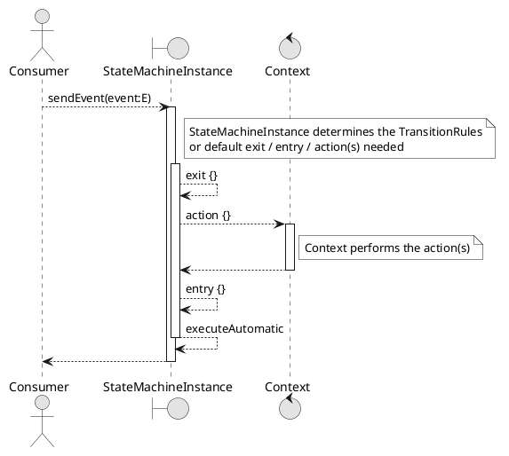

== Getting Started

=== Repository

Releases are on Maven Central.
Snapshots are in the GitHub Packages Maven repository.
Contact us for a personal access token (PAT) to get snapshot releases.

=== Dependencies

==== Kotlin Multiplatform (`build.gradle.kts`)

[source,kotlin,subs="attributes+"]
----
repositories {
    mavenCentral()
}

kotlin {
    sourceSets {
        commonMain.dependencies {
            implementation("org.infosmid:kfsm:{project-version}")
        }
    }
}
----

==== Kotlin Multiplatform (`build.gradle` - Groovy DSL)

[source,groovy,subs="attributes+"]
----
repositories {
    mavenCentral()
}

kotlin {
    sourceSets {
        commonMain {
            dependencies {
                implementation 'org.infosmid:kfsm:{project-version}'
            }
        }
    }
}
----

==== Single Platform (JVM / Android)

===== Kotlin DSL (`build.gradle.kts`)

[source,kotlin,subs="attributes+"]
----
repositories {
    mavenCentral()
}

dependencies {
    implementation("org.infosmid:kfsm:{project-version}")
}
----

===== Groovy DSL (`build.gradle`)

[source,groovy,subs="attributes+"]
----
repositories {
    mavenCentral()
}

dependencies {
    implementation 'org.infosmid:kfsm:{project-version}'
}
----

==== Gradle version catalog (`gradle/libs.versions.toml`)

Declare the library in the version catalog:

[source,toml,subs="attributes+"]
----
[versions]
kfsm = "{project-version}"

[libraries]
infosmid-kfsm = { module = "org.infosmid:kfsm", version.ref = "kfsm" }
----

Then use the catalog accessor in the build script.

For Kotlin Multiplatform

==== Kotlin Multiplatform

[source,groovy]
----
repositories {
    mavenCentral()
}

kotlin {
    sourceSets {
        commonMain {
            dependencies {
                implementation(libs.infosmid.kfsm)
            }
        }
    }
}
----

For a single platform (JVM / Android)

==== Single Platform

[source,groovy]
----
repositories {
    mavenCentral()
}

dependencies {
    implementation(libs.infosmid.kfsm)
}
----

== Finite State Machines

This section describes the life cycle and the design of kfsm.

=== Terms

Some terms have a specific meaning in kfsm.
Use this list to avoid confusion with other meanings of the same words.

State machine::
The object that processes events.
In this document, _state machine_ means a state machine that you define with kfsm.
`FSM` is the short form that code and diagrams use.

State (`S`)::
A value that describes the situation of the context.
A state can be any value that has `equals` and `hashCode`.
Most examples use an `enum class`.

Event (`E`)::
A value that you send to the state machine.
An event can cause a transition.
Like a state, an event is any value that has `equals` and `hashCode`.

Argument (`A`)::
A value that you send together with an event.
All events of one state machine have the same argument type.
This is not a Kotlin function argument.

Return value (`R`)::
The value that `sendEvent` returns.
It is the result of the action that ran.

Context (`C`)::
The object that the actions operate on.
The action lambdas use the context as `this`.
This is not a `CoroutineContext`.

Action::
A lambda that the state machine runs during a transition.
An action is not a user interface action or an event.

Transition::
The change that an event causes.
A transition can run actions and can change the state.

External transition::
A transition that has a target state.
The state machine runs the exit action and the entry action.
This is true also when the target state is the same as the current state.

Internal transition::
A transition that has no target state.
The state stays the same.
The state machine does not run the exit action or the entry action.

Guard expression::
A lambda that returns a `Boolean`.
A transition that has a guard expression occurs only when the guard returns `true`.

Entry action and exit action::
Actions that run for an external transition.
The exit action runs for the current state.
The entry action runs for the target state.

Default action::
An action that runs when no transition matches the current state and the event.
This is not the default value of a Kotlin parameter.

State map::
A group of states with their transitions and actions.
This is not a Kotlin `Map`.
A state machine has one top-level state map and can have named state maps.

Default state map::
The top-level state map.
Its name is `default`.

Push transition and pop transition::
Transitions that change the current state map.
A push transition puts the current state map on a stack and makes a named state map current.
A pop transition removes the current state map from the stack.
The previous state map becomes current.

Automatic transition::
A transition that has no event.
The state machine selects it after another transition completes.

Timeout transition::
A transition that has no event.
It occurs when a configured time expires after the state machine enters the state.
Only asynchronous state machines have timeout transitions.

Definition::
The immutable description of a state machine.
You can share one definition.

Instance::
A state machine that you create from a definition.
An instance has a context and a current state.

Externalized state::
A list of pairs of a state and a state map name.
You can store it and use it to create an instance later.

Invariant::
A condition that must be `true` before and after every transition.

=== Definition

You define a state machine with a DSL, as this document describes.

In the definition, you describe:

* The types of the states and the events.
* The behavior of the state machine for each event.
* How the actions operate on the context.

State types and event types must be value types.
They must have `equals` and `hashCode`.
An `enum class` is a good choice, but it is not necessary.

When `kfsm-viz` creates a state diagram, it uses the states `START` and `END` as the start state and the end state.

An event can have an argument and can return a value.
The argument type is the same for all events.
To send different types of arguments, use a sealed class as the argument type.

A state machine has one or more state maps.
Each state map has a subset of the states.

The definition lists the events of the state machine.

The state machine applies actions to a context.
The context represents the work that the state machine does.

An event can cause a transition.
A transition defines the actions that the state machine runs when it is in a specific state.

A transition can have a guard expression.
The transition occurs only when the guard returns `true`.

An automatic transition belongs to a state and has no event.
The state machine selects an automatic transition after another transition completes and the state is the current state.

A timeout transition belongs to a state.
It occurs when a configured time expires after the state machine enters the state.
If the transition has a guard expression, the guard must return `true`.

=== Instance

You create an instance from a definition.
You give the instance a context.
You can also give it an externalized state.
The definition can also derive the current state from the context.

You send events to the instance.
If the event needs an argument, you send it together with the event.
An event can cause the state machine to run actions.

You can ask the instance which events the current state allows.
You can also ask for the events of a given state.
Use this to disable controls in a user interface.
A back-end application that uses HATEOAS can use it to add only the links for allowed events.

If a state machine has timeout transitions, the instance must stay active.
This is usually necessary only in user interface applications and in embedded interactive applications.

In a stateless environment, requests or events drive the application.
If the state is not derived from the context, externalize the state after you use the instance.
The externalized state is a list of pairs.
Each pair has a state and the name of its state map.

==== Initial State

An instance needs an initial state.
The state machine uses the first of these that is available:

. The externalized state that you give to `create`.
. The `initialStates` expression.
. The initial state that you give to `create`.
. The `initialState` expression.
. The `defaultInitialState`.

If none is available, `create` throws an exception.

=== Named Maps and Push / Pop Transitions

A named state map is a group of states.
A push transition goes to a named state map.
A pop transition returns from it.

A push transition needs:

* The name of the target state map.
* The target state.
* The event, as for a normal transition.
* Optionally, a guard expression and an action.

When a push transition occurs, the state machine puts the current state map on a stack.
Then it creates an instance of the named state map.
This instance becomes the current state map.
The state machine processes events with the transition rules of the current state map.

A pop transition removes the current state map from the stack.
The previous state map becomes the current state map.
If the pop transition has a target state, the state of the previous state map changes to the target state.
If the pop transition has a target map, a push transition follows.

== DSL

The DSL is the way to configure a state machine.
It supports:

* Internal transitions and external transitions.
** A transition is external when it has a target state, also when the target state is the same as the current state.
* Guard expressions.
* Entry actions and exit actions for each state and for all states.
* Default actions for each state and for all states.
* Named state maps.
* Push transitions and pop transitions.
* Automatic transitions.
* Timeout transitions.
* Actions that are `suspend` functions.
* An invariant. The state machine checks the invariant for all events. If the invariant is not `true`, it throws an `InvariantException`.

All configuration calls are applied to link:javadoc/kfsm/org.infosmid.kfsm/-state-machine-builder/index.html[StateMachineBuilder].

=== `stateMachine`

The top-level element is `stateMachine`.
Use one of these functions:

* link:javadoc/kfsm/org.infosmid.kfsm/-state-machine-builder/state-machine.html[StateMachineBuilder::stateMachine]
* link:javadoc/kfsm/org.infosmid.kfsm/state-machine.html[stateMachine]

Two more overloads of `stateMachine` use `Any` as the return type and as the argument type.
Use them when the state machine does not use the argument or the return value.

[source,kotlin,numbered]
----
// using global function
val definition = stateMachine(
    State.values().toSet(),
    Event.values().toSet(),
    ContextType::class,
    ArgType::class,
    ReturnType::class
) {
    defaultInitialState = State.S1 // optional start state
    invariant { } // invariant for stateMachine
    default { // global defaults
    }
    initialState { // initial state expression
    }
    initialStates { // define expression for deriving state stack for nested maps.
    }
    onStateChange { // define an event handler to be invoked after a transition when the state has changed.

    }
    stateMap { // define named statemap
    }
    whenState { // state definition
    }
}.build()
----

=== `functionalStateMachine`

The top-level element is `functionalStateMachine`.
Use this function:

* link:javadoc/kfsm/org.infosmid.kfsm/functional-state-machine.html[functionalStateMachine]

It is the same as `stateMachine`, but the context type, the argument type and the return type are the same type.
Use it with an immutable context.

[source,kotlin,numbered]
----
// using global function
val definition = functionalStateMachine(
    State.values().toSet(),
    Event.values().toSet(),
    ContextType::class
) {
    defaultInitialState = State.S1 // optional start state
    invariant { } // invariant for stateMachine
    default { // global defaults
    }
    initialState { // initial state expression
    }
    initialStates { // define expression for deriving state stack for nested maps.
    }
    onStateChange { // define an event handler to be invoked after a transition when the state has changed.

    }
    stateMap { // define named statemap
    }
    whenState { // state definition
    }
}.build()
----

=== `asyncStateMachine`

Use `asyncStateMachine` to create a definition where the actions are `suspend` functions.
It also adds the timeout transitions to the state map handlers.
To create an instance from the definition, give it a `CoroutineScope`.

* link:javadoc/kfsm/org.infosmid.kfsm.async/async-state-machine.html[asyncStateMachine]
* link:javadoc/kfsm/org.infosmid.kfsm.async/-async-state-machine-builder/state-machine.html[AsyncStateMachineBuilder::stateMachine]

Two more overloads of `asyncStateMachine` use `Any` as the return type and as the argument type.
Use them when the state machine does not use the argument or the return value.

[source,kotlin,numbered]
----
// using global function
val definition = asyncStateMachine(
    State.values().toSet(),
    Event.values().toSet(),
    ContextType::class,
    ArgType::class,
    ReturnType::class
) {
    defaultInitialState = State.S1 // optional
    invariant { } // invariant for stateMachine
    default { // global defaults
    }
    initialState { // initial state expression
    }
    initialStates { // define expression for deriving state stack for nested maps.
    }
    onStateChange { // define an event handler to be invoked after a transition when the state has changed.

    }
    stateMap { // define named statemap
    }
    whenState { // state definition
    }
}.build()
----

=== `asyncFunctionalStateMachine`

`asyncFunctionalStateMachine` is the same as `asyncStateMachine`, but the context type, the argument type and the return type are the same type.

* link:javadoc/kfsm/org.infosmid.kfsm.async/async-functional-state-machine.html[asyncFunctionalStateMachine]

[source,kotlin,numbered]
----
// using global function
val definition = asyncFunctionalStateMachine(
    State.values().toSet(),
    Event.values().toSet(),
    ContextType::class
) {
    defaultInitialState = State.S1 // optional
    invariant { } // invariant for stateMachine
    default { // global defaults
    }
    initialState { // initial state expression
    }
    initialStates { // define expression for deriving state stack for nested maps.
    }
    onStateChange { // define an event handler to be invoked after a transition when the state has changed.

    }
    stateMap { // define named statemap
    }
    whenState { // state definition
    }
}.build()
----

=== `default`

* Handler: link:javadoc/kfsm/org.infosmid.kfsm/-dsl-state-machine-handler/default.html[DslStateMachineHandler::default]
* Mandatory: _Optional_
* Cardinality: _Multiple_

Use `default` to configure the entry action, the exit action and the action for all states.

Example:

[source,kotlin,numbered]
----
default {
    action { // global action
    }
    onEntry { // global state entry action
    }
    onExit { // global state exit action
    }
    onEvent { // default transitions
    }
}
----

==== `action`

* Handler: link:javadoc/kfsm/org.infosmid.kfsm/-dsl-state-map-default-event-handler/action.html[DslStateMachineDefaultEventHandler::action]
* Mandatory: _Optional_
* Cardinality: _Single_

Give a lambda of type `C.(S, E, A?) -> R?`.
The state machine runs it when no other transition matches.

Example:

[source,kotlin,numbered]
----
action { currentState, event, arg -> // global default action
    contextFunction()
    anotherContextFunction()
}
----

==== `onEntry`

* Handler: link:javadoc/kfsm/org.infosmid.kfsm/-dsl-state-map-default-event-handler/on-entry.html[DslStateMachineDefaultEventHandler::onEntry]
* Mandatory: _Optional_
* Cardinality: _Single_

Give a lambda of type `C.(S, S, A?) -> Unit`.
The state machine runs it for each external transition, before the state changes.
The state machine runs the global entry action after the entry action of the state.

Example:

[source,kotlin,numbered]
----
onEntry { fromState, targetState, arg ->
    entryAction()
}
----

==== `onExit`

* Handler: link:javadoc/kfsm/org.infosmid.kfsm/-dsl-state-map-default-event-handler/on-exit.html[DslStateMachineDefaultEventHandler::onExit]
* Mandatory: _Optional_
* Cardinality: _Single_

Give a lambda of type `C.(S, S, A?) -> Unit`.
The state machine runs it for each external transition, before the state changes.
The state machine runs the global exit action after the exit action of the state.

Example:

[source,kotlin,numbered]
----
onExit { fromState, targetState, arg ->
    exitAction()
}
----

==== `onEvent`

* Arguments: `(event: E [to targetState: S])`
* Handler: link:javadoc/kfsm/org.infosmid.kfsm/-dsl-state-map-default-event-handler/on-event.html[DslStateMachineDefaultEventHandler::onEvent]
* Mandatory: _Optional_
* Cardinality: _Multiple_

Use `onEvent` to define a transition for an event when no other transition matches.
There are two variations.
The first variation is an internal transition and has no target state.
The second variation is an external transition and has a target state.
In both variations, the lambda type is `C.(A?) -> R?`.

Example:

[source,kotlin,numbered]
----
onEvent(Event.EVENT) { arg -> // default internal state action for given event
    someFunction()
}

onEvent(Event.EVENT to State.STATE) { arg -> // default external state action for given event
    anotherFunction()
}
----

=== `initialState`

* Handler: link:javadoc/kfsm/org.infosmid.kfsm/-dsl-state-machine-handler/initial-state.html[DslStateMachineHandler::initialState]
* Mandatory: _Optional_
* Cardinality: _Single_

Give a lambda of type `C.() -> S`.
The lambda derives the state of the state machine from the context.

Example:

[source,kotlin,numbered]
----
initialState {
    when(flag) {
        1 -> State.S1
        2 -> State.S2
        else -> error("Invalid state")
    }
}
----

=== `initialStates`

* Handler: link:javadoc/kfsm/org.infosmid.kfsm/-dsl-state-machine-handler/initial-states.html[DslStateMachineHandler::initialStates]
* Mandatory: _Optional_
* Cardinality: _Single_

If the state machine has named state maps, you must use `initialStates`.
You cannot use `initialState` with named state maps.

Give a lambda of type `C.() -> StateMapList<S>`.
The lambda derives the state map stack from the context.
It returns a list of pairs of a state and a state map name.
The first pair is the bottom of the stack.
The last pair is the current state map.

Example:

[source,kotlin,numbered]
----
initialStates {
    mutableListOf<StateMapItem<PayingTurnstileStates>>().apply {
        if (locked) {
            this.add(PayingTurnstileStates.LOCKED to "default")
        } else {
            this.add(PayingTurnstileStates.UNLOCKED to "default")
        }
        if (coins > 0) {
            this.add(PayingTurnstileStates.COINS to "coins")
        }
    }.toMap()
}
----

=== `onStateChange`

* Handler: link:javadoc/kfsm/org.infosmid.kfsm/-dsl-state-machine-handler/on-state-change.html[DslStateMachineHandler::onStateChange]
* Mandatory: _Optional_
* Cardinality: _Single_

Give a lambda of type `C.(S, S) -> Unit`.
The first argument is the previous state.
The second argument is the new state.

The state machine runs this lambda after a transition completes and the new state is in effect.
It does not run the lambda when the state stays the same.
The exit actions and the entry actions run before the state changes.
Inside these actions, a check of the allowed events still shows the previous state.

The state machine catches an exception from the lambda.
It does not throw the exception again.

=== `whenState`

* Arguments: `(currentState: S)`
* Handler: link:javadoc/kfsm/org.infosmid.kfsm/-dsl-state-machine-handler/when-state.html[DslStateMachineHandler::whenState]
* Mandatory: _Mandatory_
* Cardinality: _Multiple_

Each `whenState` block describes the transitions for one state.

Example:

[source,kotlin,numbered]
----
whenState(State.STATE) {
    default { // default action for State.STATE
    }
    onEntry { // entry action for State.STATE
    }
    onExit { // exit action for State.STATE
    }
    onEvent(Event.EV2 to State.S1, guard = {flag == 1 }) { // external transition with guard expression
    }
    onEventPush(Event.EV2, "mapName", State.S1, guard = { flag == 1}) { // push transition to new map with guard expression
    }
    onEventPop(Event.EV3, "newMap", State.S3) { // pop transition leading into new push transition while executing current action only
    }
    automatic(State.S1, guard = { flag == 1}) { // automatic transition to new state when guard is met
    }
    // timeout is limited to AsyncStateMachineBuilder
    timeout(State.S1, timeout, [guard = { expression }]) { // transition to S1 when timeout is triggered and guard is true
    }
    timeoutPop(State.S1, timeout, [guard = { expression }]) { // pop transition to S1 when timeout is triggered and guard is true
    }
    timeoutPush(State.S1, "mapName",  timeout, [guard = { expression }]) { // push transition to S1 in "mapName" when timeout is triggered and guard is true
    }
}
----

==== `default`

* Handler: link:javadoc/kfsm/org.infosmid.kfsm/-dsl-state-map-event-handler/default.html[DslStateMachineEventHandler::default]
* Mandatory: _Optional_
* Cardinality: _Single_

A state block can have one default action.
It is a lambda of type `C.(S, E, A?) -> R?`.
The state machine runs it when no transition matches the state, the event and the guard expressions.

Example:

[source,kotlin,numbered]
----
default { fromState, event, arg -> // default state action
    someDefaultAction()
}
----

==== `onEntry`

* Handler: link:javadoc/kfsm/org.infosmid.kfsm/-dsl-state-map-event-handler/on-entry.html[DslStateMachineEventHandler::onEntry]
* Mandatory: _Optional_
* Cardinality: _Single_

Give a lambda of type `C.(S, S, A?) -> Unit`.
The state machine runs it for an external transition that has this state as the target state.
It runs after the transition action.

Example:

[source,kotlin,numbered]
----

onEntry { fromState, targetState, arg -> // state entry action
    println("Entering:$targetState from $fromState with $arg")
}
----

==== `onExit`

* Handler: link:javadoc/kfsm/org.infosmid.kfsm/-dsl-state-map-event-handler/on-exit.html[DslStateMachineEventHandler::onExit]
* Mandatory: _Optional_
* Cardinality: _Single_

Give a lambda of type `C.(S, S, A?) -> Unit`.
The state machine runs it for an external transition that starts in this state.
It runs before the transition action.

Example:

[source,kotlin,numbered]
----
onExit { fromState, targetState, arg -> // state exit action
    println("Exiting:$fromState to $targetState with $arg")
}
----

==== `automatic`

* Arguments: `(targetState: S [, guard:{}])`
* Handler: link:javadoc/kfsm/org.infosmid.kfsm/-dsl-state-map-event-handler/automatic.html[DslStateMachineEventHandler::automatic]
* Mandatory: _Optional_
* Cardinality: _Multiple_

There are two variations of the automatic transition.
One variation has a guard expression.
The other variation has no guard expression.

The state machine selects an automatic transition after it completes a transition, when this state is the current state.
It selects the transition in the same way as for an event.
The first guard that returns `true` selects the transition.
If no guard returns `true`, the state machine uses the transition that has no guard.

Example:

[source,kotlin,numbered]
----
whenState(State.S1) {
    automatic(State.S1, guard = { flag == 1}) { // automatic transition to new state when guard is met
    }
    automatic(State.S1) { // automatic transition to new state
    }
}
----

==== `automaticPop`

* Arguments: `([targetMap: String,][,targetState: S] [, guard:{}])`
* Handler: link:javadoc/kfsm/org.infosmid.kfsm/-dsl-state-map-event-handler/automatic-pop.html[DslStateMachineEventHandler::automaticPop]
* Mandatory: _Optional_
* Cardinality: _Multiple_

There are six variations of the automatic pop transition.
Each variation has or does not have a guard expression.
Each variation has no target, a target state, or a target map and a target state.
If the transition has a target map, a push transition follows the pop transition.

Example:

[source,kotlin,numbered]
----
whenState(State.S1) {
    automaticPop { // pop when S1
    }
    automaticPop(guard= { flag == 1 }) { // pop when S1 and guard is true
    }
    automaticPop(State.S2, guard = { flag == 1 }) { // automatic pop transition to new state when guard is met
    }
    automaticPop(State.S2) { // automatic pop transition to new state
    }
    automaticPop("map1", State.S2) { // automatic pop transition to push transition to new state in target map
    }
    automaticPop("map1", State.S2, guard={flag == 1 }) { // automatic pop transition to push transition to new state in target map
    }
}
----

==== `automaticPush`

* Arguments: `(targetMap: String, targetState: S [, guard:{}])`
* Handler: link:javadoc/kfsm/org.infosmid.kfsm/-dsl-state-map-event-handler/automatic-push.html[DslStateMachineEventHandler::automaticPush]
* Mandatory: _Optional_
* Cardinality: _Multiple_

There are two variations of the automatic push transition.
One variation has a guard expression.
The other variation has no guard expression.

Example:

[source,kotlin,numbered]
----
whenState(State.S1) {
    automaticPush("map1", State.S2) { // automatic push transition to S2 in target map "map1"
    }
    automaticPush("map1", State.S2, guard={flag == 1 }) { // automatic push transition to S2 in target map "map1" if guard is true
    }
}
----

==== `onEvent`

* Arguments: `(event: E [to targetState: S],[guard: {}])`
* Handler: link:javadoc/kfsm/org.infosmid.kfsm/-dsl-state-map-event-handler/on-event.html[DslStateMachineEventHandler::onEvent]
* Mandatory: _Optional_
* Cardinality: _Multiple_

There are four variations of the transition.
A transition is external or internal.
It has or does not have a guard expression.

`onEvent` defines the transition for an event.
An external transition must have a target state.
An internal transition must not have a target state.
A transition can have a guard expression.

The order in which the DSL reads the guard expressions is the order of evaluation.
The first guard that returns `true` selects the transition.
For one state and one event, only one transition can have no guard expression.

Examples:

[source,kotlin,numbered]
----
onEvent(Event.EV1, guard = { flag == 1 }) { arg -> // internal transition with guard expression
}
onEvent(Event.EV1 to State.S2, guard = { flag == 2}) { arg -> // external transition with guard expression
}
onEvent(Event.EV1) { arg -> // internal transition
}
onEvent(Event.EV2 to State.S2) { arg -> // external transition
}
----

==== `onEventPush`

* Arguments: `(event: E, targetMap: String, targetState: S [, guard:{}])`
* Handler: link:javadoc/kfsm/org.infosmid.kfsm/-dsl-state-map-event-handler/on-event-push.html[DslStateMachineEventHandler::onEventPush]
* Mandatory: _Optional_
* Cardinality: _Multiple_

There are two variations of the push transition.
One variation has a guard expression.
The other variation has no guard expression.

Example:

[source,kotlin,numbered]
----
whenState(State.S1) {
    onEventPush(Event.EV2, "mapName", State.S2) { // push transition to S2 in new map "mapName"
    }
    onEventPush(Event.EV2, "mapName", State.S2, guard = { flag == 1}) { // push transition to S2 in new map "mapName" with guard expression
    }
}
----

==== `onEventPop`

* Arguments: `(event: E [to targetState: S]|[,targetMap: String, targetState: S], [guard:{}])`
* Handler: link:javadoc/kfsm/org.infosmid.kfsm/-dsl-state-map-event-handler/on-event-pop.html[DslStateMachineEventHandler::onEventPop]
* Mandatory: _Optional_
* Cardinality: _Multiple_

There are six variations of the pop transition.
Each variation has or does not have a guard expression.
Each variation has no target, a target state, or a target map and a target state.
If the transition has a target map, a push transition follows the pop transition.

Example:

[source,kotlin,numbered]
----
whenState(State.S1) {
    onEventPop(Event.EV3) { // pop transition without targetState
    }
    onEventPop(Event.EV3, guard={ flag == 1 }) { // pop transition without targetState and guard expression
    }
    onEventPop(Event.EV3 to State.S2) { // pop transition on EV3 changing state to S2
    }
    onEventPop(Event.EV3 to State.S2, guard={ flag == 1 }) { // pop transition on EV3 changing state to S2 with a guard expression
    }
    onEventPop(Event.EV3, "newMap", State.S3) { // pop transition leading into new push transition to S3 in "newMap"
    }
    onEventPop(Event.EV3, "newMap", State.S3, guard={ flag == 1 }) { // pop transition leading into new push transition to S3 in "newMap" with a guard expression
    }
}
----

==== `timeout`

* Arguments: `(targetState: S, timeout: Long | C.() -> Long, [guard:{}])`
* Handler: link:javadoc/kfsm/org.infosmid.kfsm.async/-async-dsl-state-map-event-handler/timeout.html[AsyncDslStateMapEventHandler::timeout]
* Mandatory: _Optional_
* Cardinality: _Multiple_

Only asynchronous state machines have timeout transitions.

The state machine starts a timer when it enters the state.
When the timer expires, the transition occurs.
The state machine cancels the timer when it processes another transition.

The timeout is in milliseconds.
Give it as a `Long`, or as a lambda that has the context as `this` and returns a `Long`.

There are four variations.
Two variations add a guard expression.
The transition occurs only when the guard returns `true`.

==== `timeoutPop`

* Arguments: `([targetMap: String], [targetState: S], timeout: Long | C.() -> Long, [guard:{}])`
* Handler: link:javadoc/kfsm/org.infosmid.kfsm.async/-async-dsl-state-map-event-handler/timeout-pop.html[AsyncDslStateMapEventHandler::timeoutPop]
* Mandatory: _Optional_
* Cardinality: _Multiple_

`timeoutPop` is a timeout transition that is also a pop transition.
The variations combine these options:

* The timeout as a `Long` or as a lambda.
* An optional guard expression.
* No target, a target state, or a target map and a target state.

If the transition has a target map, a push transition follows the pop transition.

==== `timeoutPush`

* Arguments: `(targetMap: String, targetState: S, timeout: Long | C.() -> Long, [guard:{}])`
* Handler: link:javadoc/kfsm/org.infosmid.kfsm.async/-async-dsl-state-map-event-handler/timeout-push.html[AsyncDslStateMapEventHandler::timeoutPush]
* Mandatory: _Optional_
* Cardinality: _Multiple_

`timeoutPush` is a timeout transition that is also a push transition.
The variations combine these options:

* The timeout as a `Long` or as a lambda.
* An optional guard expression.

== Operation

After you define a state machine, you can create an instance.
You give the instance a context.
You can also give it an externalized state.

When you call `sendEvent`, the state machine applies the event to the current state map.
The current state map is the top-level state map, unless you defined named state maps and a push transition occurred.

=== Send Event

For an external transition, the state machine runs these actions in this order:

* `sendEvent`
** `exitAction()`
** `action()`
** `entryAction()`

For an internal transition, the state machine runs only `action()`.

The state machine runs the exit action of the state first.
Then it runs the default exit action.
The exit action of the state is `whenState/onExit`.
If the current state map has no such action, the state machine uses `whenState/onExit` of the default state map.
The default exit action is `stateMap/default/onExit`.
If the current state map has none, the state machine uses the default exit action of the default state map.

The action is the first of these that exists:

* `stateMap/whenState/onEvent`
* `stateMap/whenState/default/action`
* `stateMap/default/action`

The state machine runs the entry action of the state first.
Then it runs the default entry action.
The entry action of the state is `whenState/onEntry`.
If the current state map has no such action, the state machine uses `whenState/onEntry` of the default state map.
The default entry action is `stateMap/default/onEntry`.
If the current state map has none, the state machine uses the default entry action of the default state map.

The current state and the event select a set of transition rules.
The definition gives these rules.
If the rules have guarded transitions, the state machine evaluates the guard expressions in order.
The first guard that returns `true` selects the transition.
If no guard returns `true`, the state machine uses the transition that has no guard.

If no transition matches, the state machine runs the default action.
If there is no default action, `sendEvent` throws an exception.

The state machine runs `onEntry` and `onExit` only for external transitions.
An external transition has a target state.
An internal transition has no target state.

The current state selects the exit action.
The target state selects the entry action.

After a transition completes, the state machine selects the automatic transitions of the current state.

=== Notes on Concurrency and Coroutines

`AsyncTimer` uses the `CoroutineScope` that you give when you create the instance.
It starts a coroutine in this scope.
The coroutine waits for the `delay` and then runs the trigger.
