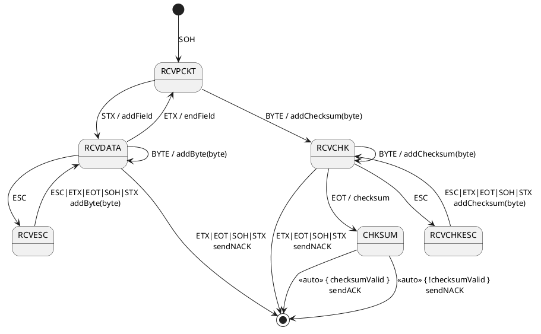

=== Simple turnstile example

Assume that you must manage the state of a simple lock.
The `lock()` function must run only when the lock is not locked.
The `unlock()` function must run only when the lock is locked.

Use the DSL to declare a state machine definition that matches the diagram:

==== State Diagram

image::turnstile_detail.png[LockStateDiagram]

==== State Table

|===
|Start State |Event |End State |Action

|LOCKED
|PASS
|LOCKED
|alarm

|LOCKED
|COIN
|UNLOCKED
|unlock

|UNLOCKED
|PASS
|LOCKED
|lock

|UNLOCKED
|COIN
|UNLOCKED
|returnCoin
|===

==== Context class

[source,kotlin,numbered]
----
include::../../commonTest/kotlin/org/infosmid/kfsm/example/TurnstileTypes.kt[tag=context]
----

==== Enums for States and Events

Declare two enums. One enum has the states. The other enum has the events.

[source,kotlin,numbered]
----
include::../../commonTest/kotlin/org/infosmid/kfsm/example/TurnstileTypes.kt[tag=states-events]
----

==== Packaged definition and execution

[source,kotlin,numbered]
----
include::../../commonTest/kotlin/org/infosmid/kfsm/example/TurnstileTypes.kt[tag=packaged]
----

==== Usage

Create an instance of the state machine. Give it the context that the actions operate on:

[source,kotlin,numbered]
----
val turnstile = Turnstile()
val fsm = TurnstileFSM(turnstile)
----

The context is independent of the state machine.

When you send an event, the state machine can run actions:

[source,kotlin,numbered]
----
// The state is LOCKED
fsm.coin()
// Expect the unlock() action. The new state is UNLOCKED
fsm.pass()
// Expect the lock() action. The new state is LOCKED
fsm.pass()
// Expect the alarm() action. The state stays LOCKED
fsm.coin()
// Expect the unlock() action. The new state is UNLOCKED
fsm.coin()
// Expect the returnCoin() action. The state stays UNLOCKED
----

link:https://github.com/infosmid-org/kfsm-samples[Samples]

=== Advanced Features

An event can have an argument.
A state machine can also have named state maps, push transitions, pop transitions and automatic transitions.

Send the argument with the event:

[source,kotlin,numbered]
----
fsm.sendEvent(EVENT1, arg)
----

The action receives the argument:

[source,kotlin,numbered]
----
onEvent(EVENT1) { arg ->
    val value = arg as Int
}
----

In this example, the COIN event has the value of the coin as its argument.
A named state map, `coins`, makes the decisions about coins.
A push transition goes to the `coins` state map and the COINS state.
Then the state machine runs an automatic transition when its guard returns `true`.

image::paying_turnstile_detail.png[Paying Turnstile]

==== State Table

|===
|Start State |Event |Guard Expression | End State | Action

|LOCKED
|PASS
|
|LOCKED
|alarm

|LOCKED
|COIN
|
|COINS
|coin(value)

|UNLOCKED
|PASS
|
|LOCKED
|lock

|COINS
|COIN
|
|COINS
|coin(value)

|COINS
|
|coins == requiredCoins
| UNLOCKED
| unlock

|COINS
|
|coins > requiredCoins
| UNLOCKED
| returnCoin(coins-requiredCoins), unlock

|===

A row without an event is an automatic transition.
The COINS state is in a named state map.
This shows how you can use state maps to group behaviour or to keep it separate.

==== Context class

The context class does not make decisions.
It stores values and changes them in specific ways.

[source,kotlin,numbered]
----
include::../../commonTest/kotlin/org/infosmid/kfsm/example/PayingTurnstileTypes.kt[tag=context]
----

==== States and Events

[source,kotlin,numbered]
----
include::../../commonTest/kotlin/org/infosmid/kfsm/example/PayingTurnstileTypes.kt[tag=states-events]
----

The definition adds a state map that is named `coins`. The state map has the state `COINS`.
The state machine enters the state map when the turnstile has coins.
The guard expressions select the automatic transitions.

==== State machine definition packaged

This example shows how to externalize the state and how to create an instance from an externalized state.
The `externalState` function returns a list of states. The list has one state for each state map on the stack.

[source,kotlin,numbered]
----
include::../../commonTest/kotlin/org/infosmid/kfsm/example/PayingTurnstileTypes.kt[tag=packaged]
----

==== Test

[source,kotlin,numbered]
----
include::../../commonTest/kotlin/org/infosmid/kfsm/example/PayingTurnstileFsmTests.kt[tag=test]
----

==== Output

[source]
----
--coin1
sendEvent:COIN:10
entering:LOCKED ([10]) for Turnstile(locked=true,coins=0)
PUSH TRANSITION
Coin received=10, Total=10
Coins=10, Please add 40
--coin2
sendEvent:COIN:60
Coin received=60, Total=70
Return Coin:20
Unlock
Reset coins=0
entering:UNLOCKED ([60]) for Turnstile(locked=false,coins=0)
--pass1
sendEvent:PASS
exiting:UNLOCKED for Turnstile(locked=false,coins=0)
Lock
entering:LOCKED for Turnstile(locked=true,coins=0)
--pass2
sendEvent:PASS
Default action for state(LOCKED) -> on(PASS) for Turnstile(locked=true,coins=0)
Alarm
--pass3
sendEvent:PASS
Default action for state(LOCKED) -> on(PASS) for Turnstile(locked=true,coins=0)
Alarm
--coin3
sendEvent:COIN:40
entering:LOCKED ([40]) for Turnstile(locked=true,coins=0)
PUSH TRANSITION
Coin received=40, Total=40
Coins=40, Please add 10
--coin4
sendEvent:COIN:10
Coin received=10, Total=50
Unlock
Reset coins=0
entering:UNLOCKED ([10]) for Turnstile(locked=false,coins=0)
----

=== Secure Turnstile Example

This turnstile reads RFID cards or NFC cards. It does not accept coins.

The turnstile also has an override card.
When the override is active, the turnstile lets any card pass, also an invalid card.

Guard expressions identify the override card and check if a card is valid.
When a user taps the override card a second time, the turnstile cancels the override or locks, depending on the state.

image::secure_turnstile_detail.png[Secure Turnstile FSM]

==== State Table

|===
|Start State |Event |Guard Expression | End State | Action

|LOCKED
|CARD(id)
| isOverrideCard(id) and overrideActive
|
| cancelOverride()

|LOCKED
|CARD(id)
|isOverrideCard(id)
|
|activateOverride()

|LOCKED
|CARD(id)
| overrideActive or isValidCard(id)
| UNLOCKED
| unlock()

|LOCKED
|CARD(id)
| not isValidCard(id)
|
| invalidCard()

|UNLOCKED
|PASS
|
|LOCKED
| lock()

| *default*
|
|
|
| buzzer()

|===

==== Context class

The context class does not make decisions about the behaviour of the turnstile.
It gives information about the state of the turnstile and about the validity of cards.
It stores values and changes them in specific ways.

[source,kotlin,numbered]
----
include::../../commonTest/kotlin/org/infosmid/kfsm/example/SecureTurnstile.kt[tag=context]
----

==== States and Events

[source,kotlin,numbered]
----
include::../../commonTest/kotlin/org/infosmid/kfsm/example/SecureTurnstile.kt[tag=states-events]
----

==== State machine definition packaged

[source,kotlin,numbered]
----
include::../../commonTest/kotlin/org/infosmid/kfsm/example/SecureTurnstile.kt[tag=fsm]
----

==== Test

[source,kotlin,numbered]
----
include::../../commonTest/kotlin/org/infosmid/kfsm/example/PayingTurnstileFsmTests.kt[tag=test]
----

=== Packet Reader Example

The diagram above combines some transitions to keep the diagram short.
In the implementation, all control characters are one type of event, and guard expressions tell them apart.
Each event has the received byte as its argument. The event type is BYTE, CTRL or ESC:

* ESC is 0x1B.
* CTRL is SOH, STX, ETX, EOT, ACK or NAK.
* BYTE is any other character.

image::packet_reader_detail.png[]

==== Context Classes

The checksum in this example is simple. The checksum has one character for each field. This character is the same as the first character of the field.

[source,kotlin,numbered]
----
include::../../commonTest/kotlin/org/infosmid/kfsm/example/PacketReaderTests.kt[tag=context]
----

==== States and Events

[source,kotlin,numbered]
----
include::../../commonTest/kotlin/org/infosmid/kfsm/example/PacketReaderTests.kt[tag=states-events]
----

==== Packaged FSM

[source,kotlin,numbered]
----
include::../../commonTest/kotlin/org/infosmid/kfsm/example/PacketReaderTests.kt[tag=packaged]
----

==== Tests

[source,kotlin,numbered]
----
include::../../commonTest/kotlin/org/infosmid/kfsm/example/PacketReaderTests.kt[tag=tests]
----

=== Immutable Context Example

Use this example when you want an immutable context. Actions do not change the context. They return a new context.

==== Immutable Context

The immutable context does not change a variable.
It returns a copy that has the new values.

[source,kotlin,numbered]
----
include::../../commonTest/kotlin/org/infosmid/kfsm/example/ImmutableLockFSM.kt[tag=context]
----

==== Definition

The definition has one function. The function applies an event to a context and returns the new context.

[source,kotlin,numbered]
----
include::../../commonTest/kotlin/org/infosmid/kfsm/example/ImmutableLockFSM.kt[tag=definition]
----

==== Usage

The example also has an overloaded `plus` operator.
Use it to apply an event to a context.

[source,kotlin]
----
include::../../commonTest/kotlin/org/infosmid/kfsm/example/ImmutableLockFSM.kt[tag=test]
----

When the argument of the action is not the context, use a `Pair`. Use a `Pair` also when you need the state separately:

[source,kotlin]
----
    val locked = ImmutablePayingTurnstile(50)
    val (state, newTurnStile) = locked + (COIN to 10)
----

In this example, the argument type is `Int`. The return type is `Pair<LockStates, ImmutablePayingTurnstile>`.
The `handleEvent` function is:

[source,kotlin]
----
    fun handleEvent(context: ImmutablePayingTurnstile, event: Pair<LockEvents, Int>): Pair<LockStates,ImmutablePayingTurnstile> {
        val fsm = definition.create(context)
        val result = fsm.sendEvent(event.first, event.second) ?: error("Expected context not null")
        return Pair(fsm.currentState, result)
    }
----

=== Secure Turnstile with Timeout Example

This example adds a timeout transition to the Secure Turnstile.
When the turnstile is UNLOCKED for 500 ms, it locks.

image::timeout_turnstile_detail.png[Timeout Secure Turnstile FSM]

==== State Table

===== TimerSecureTurnstileFSM State Map

|===
| Start | Event[Guard] | Target | Action

| LOCKED
| CARD `[{cardId->requireNotNull(cardId);isOverrideCard(cardId)&&overrideActive;}]`
| LOCKED
a| [source,kotlin]

----
{
cancelOverride()
}
----

| LOCKED
| CARD `[{cardId->requireNotNull(cardId);isOverrideCard(cardId);}]`
| LOCKED
a| [source,kotlin]

----
{
activateOverride()
}
----

| LOCKED
| CARD `[{cardId->requireNotNull(cardId);overrideActive\|\|isValidCard(cardId);}]`
| UNLOCKED
a| [source,kotlin]

----
{
unlock()
}
----

| LOCKED
| CARD `[{cardId->requireNotNull(cardId){"cardId is required"};!isValidCard(cardId);}]`
| LOCKED
a| [source,kotlin]

----
{cardId->
requireNotNull(cardId)
invalidCard(cardId)
}
----

| UNLOCKED
| \<<timeout = 500>>
| LOCKED
a| [source,kotlin]

----
{
println("Timeout. Locking")
lock()
}
----

| UNLOCKED
| CARD `[{cardId->requireNotNull(cardId);isOverrideCard(cardId);}]`
| LOCKED
a| [source,kotlin]

----
{
lock()
}
----

| UNLOCKED
| PASS
| LOCKED
a| [source,kotlin]

----
{
lock()
}
----
|===

==== Context class

The context class does not make decisions about the behaviour of the turnstile.
It gives information about the state of the turnstile and about the validity of cards.
It stores values and changes them in specific ways.

[source,kotlin,numbered]
----
include::../../commonTest/kotlin/org/infosmid/kfsm/example/TimeoutSecureTurnstile.kt[tag=context]
----

==== States and Events

[source,kotlin,numbered]
----
include::../../commonTest/kotlin/org/infosmid/kfsm/example/TimeoutSecureTurnstile.kt[tag=states-events]
----

==== State machine definition packaged

[source,kotlin,numbered]
----
include::../../commonTest/kotlin/org/infosmid/kfsm/example/TimeoutSecureTurnstile.kt[tag=fsm]
----

==== Test

[source,kotlin,numbered]
----
include::../../jvmTest/kotlin/org/infosmid/kfsm/example/TimeoutSecureTurnstileTests.kt[tag=test]
----

=== Further thoughts

The escape handling of the packet reader can be a separate state map.
The current implementation has a problem: the escaped byte must go into a different buffer.

A state map could receive a different context from the main context.
This context would be an interface or a class that shows only a part of the full context.
In this example, the state map would receive `Block`.
The state map adds the byte and then runs a pop transition.
If the character is not valid, the state map still goes to the end state.

